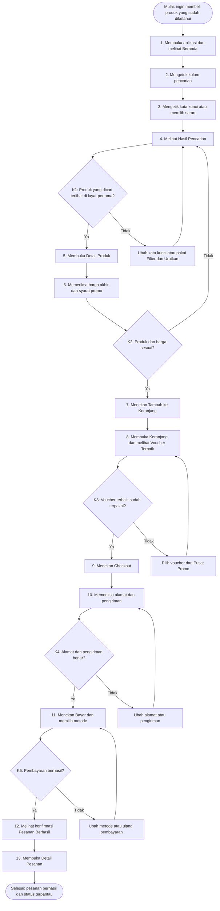

# PRD: Redesign Alur Belanja Tokopedia (Beranda sampai Pesanan)

| | |
|---|---|
| Versi | 1.0 (draft untuk prototype) |
| Penyusun | Restu Almanzil Akyla Fajni |
| Mata kuliah | Rekayasa Interaksi (UX) |
| Tanggal | 22 November 2026 |
| Status | Konsep mahasiswa, bukan produk atau dokumen resmi Tokopedia |

## 1. Ringkasan

Dokumen ini menjelaskan konsep prototype mobile web yang memperbaiki alur belanja pada aplikasi e-commerce Tokopedia untuk pengguna yang **sudah tahu produk apa yang ingin dibeli**. Fokusnya adalah membuat pencarian dan produk lebih menonjol dibanding promosi, tanpa menghilangkan promo yang relevan, lalu menjaga alur sampai pembayaran dan pemantauan pesanan tetap ringkas.

Prototype dibangun dengan data dummy, tanpa backend, dan tanpa pembayaran nyata.

## 2. Latar Belakang dan Masalah

Pengamatan pada Worksheet 1 dan 2 menunjukkan elemen promosi (banner, widget, ikon melayang, label diskon) tampil berlapis di Beranda, Daftar Produk atau Hasil Pencarian, dan Checkout. Akibatnya kolom pencarian, informasi produk, dan tombol checkout kurang menonjol dibanding promosinya.

Gejala yang diamati:

1. Kolom pencarian atau produk yang dituju tertutup atau terdesak banner.
2. Pengguna dapat tanpa sengaja mengetuk banner atau ikon promo.
3. Checkout terasa berbelit karena tawaran tambahan muncul sebelum tombol bayar.
4. Label diskon yang berlaku sulit dibedakan dari dekorasi visual.

**Design challenge:** Bagaimana membantu pengguna Tokopedia menemukan produk yang mereka butuhkan dengan cepat di halaman beranda, tanpa kehilangan akses terhadap promo yang benar-benar relevan bagi mereka?

## 3. Tujuan dan Non-Tujuan

### Tujuan

- G1. Pengguna dapat menemukan produk yang sudah diketahui dengan cepat dari Beranda.
- G2. Pengguna tetap dapat mengakses promo yang relevan tanpa promo menutupi pencarian dan tombol utama.
- G3. Pengguna yakin pada harga akhir dan voucher yang terpakai sebelum membayar.
- G4. Pengguna dapat menyelesaikan alur dari Beranda sampai melihat status pesanan.

### Non-tujuan

- Sisi penjual, iklan, dan dashboard toko.
- Pembayaran nyata, akun nyata, pengiriman nyata, dan backend.
- Personalisasi nyata berbasis algoritma (promo relevan disimulasikan dengan aturan sederhana pada data dummy).

## 4. Pengguna Sasaran

**Pembeli Rutin (Segmen A)**, hasil Worksheet 3 dan 6.

- Usia sekitar 18 sampai 40 tahun, belanja rutin lewat smartphone.
- Tujuan: menemukan produk yang dibutuhkan dengan cepat lalu membayar tanpa gangguan.
- Konteks: sesi singkat di sela waktu luang, sering terburu buru.
- Kemampuan teknologi: menengah sampai tinggi.

Pembanding: pemburu promo, yaitu pengguna yang justru memanfaatkan banner dan voucher. Prototype tidak boleh menghapus promo, hanya menatanya.

## 5. Kebutuhan UX (dari Worksheet 8)

Setiap kebutuhan memiliki kriteria penerimaan yang dapat diuji. Angka target adalah **target usulan** yang akan divalidasi pada usability test.

| Kode | Kebutuhan UX (pengguna membutuhkan ... agar ...) | Kriteria penerimaan |
|---|---|---|
| UX-01 | Kolom pencarian yang langsung terlihat dan mudah dijangkau di beranda agar pencarian dapat dimulai tanpa menggulir atau menyaring banner | Kolom pencarian terlihat tanpa menggulir pada layar 360 px. Minimal 4 dari 5 peserta uji mengetuknya dalam 5 detik pertama |
| UX-02 | Produk hasil pencarian yang lebih menonjol daripada promo agar produk yang dituju tidak terdesak ke bawah | Produk pertama hasil pencarian tampil pada layar pertama tanpa menggulir |
| UX-03 | Area ketuk yang aman dan elemen melayang yang tidak mengganggu agar tidak salah sentuh dan alur tidak terputus | Tidak ada elemen yang melayang di atas konten. Minimal 4 dari 5 peserta tidak salah sentuh promo pada tugas pencarian |
| UX-04 | Harga akhir dan syarat promo yang jelas pada kartu produk agar yakin pada harga yang berlaku tanpa menghitung sendiri | Harga akhir dan syarat singkat tampil pada kartu produk, detail produk, dan keranjang dengan istilah seragam. Minimal 4 dari 5 peserta menyebutkan harga akhir dengan benar |
| UX-05 | Promo yang relevan dengan produk atau kategori yang sedang dicari agar tetap mendapat penawaran berguna tanpa menyaring semua promo | Promo yang tampil mengikuti kategori yang sedang dicari. Minimal 4 dari 5 peserta menilainya relevan (skor 4 atau 5 dari 5) |
| UX-06 | Kepastian bahwa voucher terbaik sudah terpakai dan alur menuju tombol bayar yang ringkas agar dapat membayar tanpa ragu dan tanpa langkah tambahan | Voucher terbaik terpilih otomatis dengan indikator. Tawaran tambahan tidak berada di antara pengguna dan tombol bayar. Tidak ada peserta yang menunda karena ragu voucher |
| UX-07 | Status pesanan yang mudah dipantau agar yakin bahwa pesanan berhasil | Konfirmasi pesanan dan halaman status ditemukan tanpa bantuan |

Catatan sumber: kebutuhan di atas mengacu pada Worksheet 8. Validasi dengan pengguna nyata pada prototype belum dilakukan.

## 6. Lingkup Fitur

| Prioritas | Fitur | Kebutuhan |
|---|---|---|
| Must | Kolom pencarian global selalu terlihat, riwayat dan saran pencarian | UX-01 |
| Must | Hasil Pencarian dengan Daftar Produk, Filter dan Urutkan | UX-02 |
| Must | Detail Produk dengan harga akhir dan syarat promo | UX-04 |
| Must | Keranjang dengan Voucher Terbaik dan ringkasan harga akhir | UX-04, UX-06 |
| Must | Checkout dan Pembayaran (simulasi) dengan pesan gagal yang jelas | UX-06 |
| Must | Konfirmasi dan Detail Pesanan dengan status dan pelacakan | UX-07 |
| Should | Promo Untuk Anda di Beranda dan Promo Terkait di hasil pencarian | UX-05 |
| Should | Pusat Promo (daftar promo dan voucher) | UX-04, UX-05 |
| Should | Pengaturan Tampilan Promo (sembunyikan banner kampanye) | UX-03 |
| Could | Beli Langsung dari Detail Produk (melewati Keranjang) | usulan tambahan |
| Won't | Akun nyata, pembayaran nyata, backend | |

## 7. Struktur Informasi (dari Worksheet 9)

Menu tingkat utama dibatasi 5 menu pada tab bar bawah, ditambah satu kolom pencarian global yang selalu terlihat di atas.

```
Tokopedia (prototype)
|-- Pencarian (global, selalu terlihat)
|   |-- Riwayat dan Saran Pencarian
|   |-- Hasil Pencarian
|   |   |-- Daftar Produk, Filter dan Urutkan, Promo Terkait
|   |-- Detail Produk
|       |-- Harga Akhir dan Syarat Promo, Ulasan, Info Toko
|-- Beranda
|   |-- Pintasan Kategori, Promo Untuk Anda, Rekomendasi Produk
|   |-- Banner Kampanye (maksimal 1)
|   |-- Pusat Promo (Voucher Saya, Detail dan Syarat Promo)
|-- Kategori (Daftar Kategori, Subkategori, Daftar Produk)
|-- Keranjang
|   |-- Daftar Item, Voucher Terbaik, Ringkasan Harga Akhir
|   |-- Checkout (Alamat dan Pengiriman, Ringkasan Pembayaran, Tawaran Tambahan opsional)
|   |-- Pembayaran (Pilih Metode, Pesanan Berhasil)
|-- Pesanan (Daftar Pesanan, Detail Pesanan: Status dan Pelacakan)
|-- Akun (Profil, Alamat, Pengaturan Tampilan Promo, Notifikasi, Bantuan)
```

## 8. Alur Pengguna Utama

**Tujuan:** membeli produk yang sudah diketahui. **Titik awal:** Beranda. **Titik akhir:** pesanan berhasil dibayar dan status terlihat.



Prototype harus dapat menjalankan seluruh alur di atas, termasuk lima cabang "Tidak".

## 9. Spesifikasi Layar

Wireframe di bawah bersifat low fidelity. Tanda `[ ]` adalah tombol atau input, `( )` adalah chip atau pilihan.

### 9.1 Beranda

Tujuan: memulai pencarian dengan cepat. Kebutuhan: UX-01, UX-03, UX-05.

```
+------------------------------------------+
| [ Cari produk di Tokopedia          (q) ] |
+------------------------------------------+
| (Elektronik) (Rumah) (Fashion) (Hobi) >  |
+------------------------------------------+
| Promo Untuk Anda          [Lihat semua]  |
| [Gratis Ongkir]  [Diskon 10%]            |
+------------------------------------------+
| Rekomendasi Produk                       |
| [Foto]        [Foto]                     |
| Nama          Nama                       |
| Rp28.000      Rp45.000                   |
+------------------------------------------+
| Beranda | Kategori | Keranjang | Pesanan | Akun |
+------------------------------------------+
```

- Kolom pencarian berada di paling atas dan tetap terlihat saat menggulir.
- Banner kampanye maksimal 1 dan berada di bawah Promo Untuk Anda, bukan di atas pencarian.
- Tidak ada ikon melayang.

### 9.2 Pencarian dan Saran

Tujuan: mengetik atau memilih kata kunci. Kebutuhan: UX-01.

```
+------------------------------------------+
| [ kabel data                  ] [Cari]   |
+------------------------------------------+
| Saran                                    |
|  kabel data usb c                        |
|  kabel data iphone                       |
| Riwayat pencarian                        |
|  charger 20w                         [x] |
+------------------------------------------+
```

### 9.3 Hasil Pencarian

Tujuan: menemukan produk yang dituju. Kebutuhan: UX-02, UX-03, UX-04, UX-05.

```
+------------------------------------------+
| [ kabel data                  ] [Cari]   |
| [Filter]  [Urutkan]                      |
+------------------------------------------+
| [Foto] Kabel Data USB-C 1 m              |
|        Rp35.000 -> Rp28.000 (hemat 20%)  |
|        Syarat: tanpa minimum belanja     |
+------------------------------------------+
| [Foto] Kabel Data USB-C 2 m              |
|        Rp50.000 -> Rp40.000 (hemat 20%)  |
+------------------------------------------+
| Promo terkait: [Gratis Ongkir min 25rb]  |
+------------------------------------------+
```

- Produk pertama harus terlihat tanpa menggulir.
- Promo hanya muncul sebagai bagian Promo Terkait, di bawah daftar atau di sela setelah produk ketiga, dan tidak menutupi produk.
- Harga akhir ditulis dengan format seragam: harga coret, harga akhir, syarat singkat.

### 9.4 Detail Produk

Tujuan: memastikan produk cocok dan harga wajar. Kebutuhan: UX-04.

```
+------------------------------------------+
| < Kembali                                |
| [Foto produk]                            |
| Kabel Data USB-C 1 m                     |
| Harga akhir  Rp28.000   (Rp35.000)       |
| Syarat promo: berlaku untuk semua varian |
| Ulasan 4,8 | Toko: Gadget Store          |
+------------------------------------------+
| [Tambah ke Keranjang]                    |
+------------------------------------------+
```

### 9.5 Keranjang

Tujuan: memastikan item dan harga akhir. Kebutuhan: UX-04, UX-06.

```
+------------------------------------------+
| Keranjang                                |
| [x] Kabel Data USB-C 1 m   - 1 +  Rp28.000|
+------------------------------------------+
| Voucher Terbaik terpakai:                |
| Gratis Ongkir  (hemat Rp10.000) [Ganti]  |
+------------------------------------------+
| Subtotal            Rp28.000             |
| Ongkir              Rp10.000             |
| Potongan voucher   -Rp10.000             |
| Total               Rp28.000             |
+------------------------------------------+
| [Checkout]                               |
+------------------------------------------+
```

- Voucher terbaik terpilih otomatis. Tombol Ganti membuka Pusat Promo (cabang K3).

### 9.6 Checkout

Tujuan: memeriksa alamat dan pengiriman. Kebutuhan: UX-06.

```
+------------------------------------------+
| Checkout                                 |
| Alamat: Rumah (dummy)          [Ubah]    |
| Pengiriman: Reguler 2-3 hari   [Ubah]    |
+------------------------------------------+
| Ringkasan pembayaran                     |
| Total               Rp28.000             |
+------------------------------------------+
| [Bayar Sekarang]                         |
+------------------------------------------+
| Tawaran tambahan (opsional): asuransi    |
| [Tambahkan]  [Lewati]                    |
+------------------------------------------+
```

- Tawaran tambahan berada di bawah tombol bayar, opsional, dan tidak menghalangi tombol bayar.

### 9.7 Pembayaran dan Konfirmasi

Tujuan: membayar dan memastikan berhasil. Kebutuhan: UX-06, UX-07.

```
+------------------------------------------+
| Pilih metode pembayaran                  |
| ( ) Transfer bank   ( ) Dompet digital   |
| [Bayar]                                  |
+------------------------------------------+
Hasil berhasil:   "Pesanan berhasil" + [Lihat Pesanan]
Hasil gagal:      "Pembayaran gagal: saldo tidak cukup"
                  [Ganti metode]  [Coba lagi]
```

- Pembayaran adalah simulasi. Sediakan cara memicu hasil gagal (misalnya metode tertentu selalu gagal) agar cabang K5 dapat diuji.

### 9.8 Detail Pesanan

Tujuan: memantau status. Kebutuhan: UX-07.

```
+------------------------------------------+
| Pesanan #TKP-001                         |
| Status: Diproses > Dikirim > Selesai     |
| (o)---(o)---( )---( )                    |
| Resi: DUMMY123456   [Lacak]              |
| Kabel Data USB-C 1 m  Rp28.000           |
+------------------------------------------+
```

### 9.9 Pusat Promo

Tujuan: memilih voucher atau melihat promo dan syaratnya. Kebutuhan: UX-04, UX-05.

```
+------------------------------------------+
| < Pusat Promo                            |
| Voucher Saya                             |
|  Gratis Ongkir  min Rp25.000   [Pakai]   |
|  Diskon 10%     min Rp50.000   [Pakai]   |
| Syarat dan ketentuan tampil di bawah     |
| setiap voucher                           |
+------------------------------------------+
```

Layar opsional: Pengaturan Tampilan Promo (UX-03) berisi saklar "Tampilkan banner kampanye" di menu Akun.

## 10. Interaksi dan Navigasi

| Dari | Aksi | Ke |
|---|---|---|
| Beranda | Ketuk kolom pencarian | Pencarian dan Saran |
| Pencarian dan Saran | Cari atau pilih saran | Hasil Pencarian |
| Beranda atau Kategori | Pilih subkategori | Hasil Pencarian |
| Hasil Pencarian | Ketuk kartu produk | Detail Produk |
| Detail Produk | Tambah ke Keranjang | Keranjang |
| Beranda | Lihat semua promo | Pusat Promo |
| Keranjang | Ganti voucher | Pusat Promo, lalu kembali ke Keranjang |
| Keranjang | Checkout | Checkout |
| Checkout | Bayar Sekarang | Pembayaran |
| Pembayaran | Berhasil | Konfirmasi, lalu Detail Pesanan |
| Pembayaran | Gagal | Tetap di Pembayaran dengan opsi ulangi atau ganti metode |
| Tab Pesanan | Pilih pesanan | Detail Pesanan |

Navigasi: tab bar bawah 5 menu, tombol kembali konsisten di kiri atas, kedalaman maksimal 3 tingkat, dan Detail Produk dapat dicapai dalam 2 ketukan dari Beranda.

## 11. Data Dummy

Prototype memakai data dummy lokal (lihat `.claude/skills/tokopedia-redesign-prototype/references/dummy-data.json`): sekitar 6 produk dengan harga coret, harga akhir, dan syarat promo, 3 voucher, 1 alamat, 2 metode pembayaran (salah satunya selalu gagal untuk pengujian), dan 1 pesanan contoh.

## 12. Persyaratan Non-Fungsional

- Mobile first, lebar acuan 360 sampai 430 px, tetap dapat dibuka di desktop.
- Area ketuk minimal 44 x 44 px, kontras teks memadai, label tombol jelas.
- Bahasa Indonesia, istilah dan nama tombol konsisten di seluruh layar.
- Tanpa backend, state disimpan di memori atau penyimpanan lokal, dapat dijalankan dengan membuka berkas HTML atau GitHub Pages.
- Waktu muat awal singkat, tanpa pustaka berat.

## 13. Rencana Pengujian

Usability test sederhana dengan 5 peserta pada prototype, tugas: "Beli kabel data dari Beranda sampai melihat status pesanan." Ukur: waktu, salah sentuh, keberhasilan, dan skor kemudahan 1 sampai 7 per tugas. Hasil dibandingkan dengan kriteria penerimaan pada bagian 5.

## 14. Risiko dan Asumsi

- Prototype adalah konsep dan tidak mencerminkan struktur resmi Tokopedia.
- Kebutuhan UX belum divalidasi pada prototype, angka target adalah usulan.
- Prasyarat diasumsikan terpenuhi: pengguna sudah masuk, alamat tersimpan, metode bayar tersedia.
- Hanya satu alur utama yang dipetakan. Alur lain (membandingkan banyak produk, pembatalan, pengembalian) di luar cakupan.

## 15. Milestone Pengerjaan

| Tahap | Hasil |
|---|---|
| M1 | Kerangka proyek, tab bar, dan data dummy |
| M2 | Sembilan layar sesuai bagian 9 |
| M3 | Interaksi dan navigasi sesuai bagian 10 |
| M4 | Pengecekan kebutuhan UX-01 sampai UX-07 dan uji alur dengan lima cabang "Tidak" |
| M5 | Usability test dan perbaikan |

## 16. Dokumen Terkait

Worksheet 3 (pengguna dan stakeholder), Worksheet 6 (Empathy Map dan Persona), Worksheet 7 (User Journey), Worksheet 8 (kebutuhan UX), Worksheet 9 (struktur informasi).
